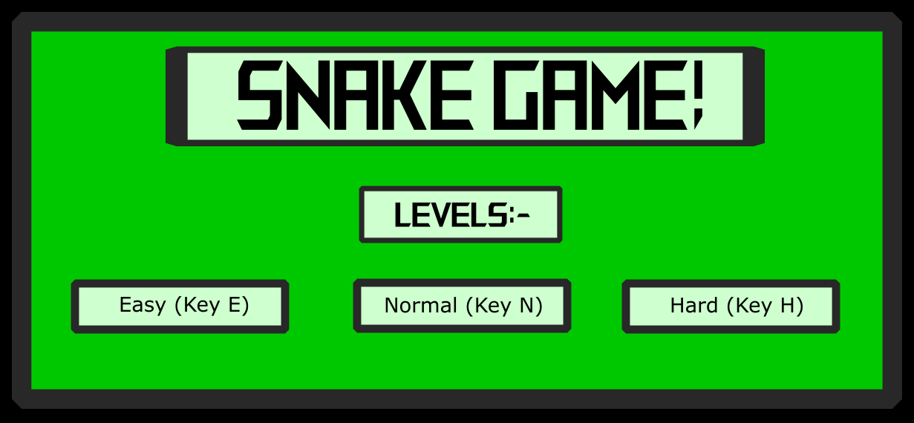

# Snake Game



A Snake game made with Python and Pygame. It has user login and register, a snake
that speeds up as it grows, and a MySQL scoreboard that tracks your previous,
minimum, and maximum scores and the overall best score.

## Controls

- Arrow keys: move the snake
- Esc: quit
- On the Game Over screen:
  - S: restart
  - O: overall maximum score
  - L: your previous score
  - N: your minimum score
  - M: your maximum score

## Requirements

- Python 3
- MySQL Server running on your computer
- Python packages: `pip install -r requirements.txt`

## Setup

1. Make sure MySQL Server is installed and running. The game creates its own
   database (`SNAKE_GAME`) and tables the first time it runs.
2. Set your MySQL password as an environment variable.
   On Windows (Command Prompt):
   ```
   setx SNAKE_DB_PASS "your_mysql_password"
   ```
   Then close and reopen your terminal or VS Code.
   Optional variables: `SNAKE_DB_HOST`, `SNAKE_DB_USER`, `SNAKE_DB_NAME`
   (defaults: localhost, root, SNAKE_GAME).
3. Run the game:
   ```
   python New_Snake_Game.py
   ```

Keep `GameOver.png`, `Logo.png`, and `start.png` in the same folder as the game file.
